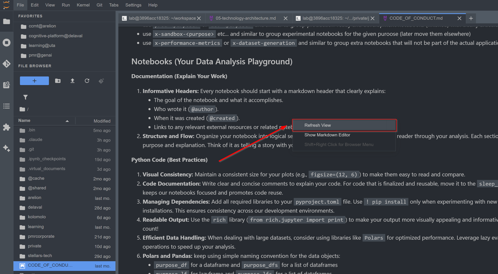

# JupyterLab Refresh View Extension

[](https://github.com/stellarshenson/jupyterlab_refresh_view_extension/actions/workflows/build.yml)
[](https://www.npmjs.com/package/jupyterlab_refresh_view_extension)
[](https://pypi.org/project/jupyterlab-refresh-view-extension/)
[](https://pepy.tech/project/jupyterlab-refresh-view-extension)
[](https://jupyterlab.readthedocs.io/en/stable/)
[](https://kolomolo.com)
[](https://www.paypal.com/donate/?hosted_button_id=B4KPBJDLLXTSA)

> [!TIP]
> This extension is part of the [stellars_jupyterlab_extensions](https://github.com/stellarshenson/stellars_jupyterlab_extensions) metapackage. Install all Stellars extensions at once: `pip install stellars_jupyterlab_extensions`

JupyterLab extension that adds a **"Refresh View"** context menu command to reload file content from disk while preserving scroll position.



## Features

The extension provides intelligent content refresh while preserving your exact position in the document. For notebooks, it identifies the visible cell in your viewport and automatically scrolls back to that cell after refresh, restoring both the cell position and viewport offset even when JupyterLab's windowed rendering progressively loads cells. For markdown and text files, it maintains precise scroll coordinates. The extension works seamlessly with [jupyterlab_tabular_data_viewer_extension](https://github.com/stellarshenson/jupyterlab_tabular_data_viewer_extension) to refresh CSV and tabular data files in their custom viewer.

- **Automatic Cell Scrolling** - Identifies visible notebook cell before refresh and automatically scrolls back to it afterward, preserving exact viewport position
- **Hybrid Position Tracking** - Cell-based anchoring for notebooks with scroll coordinate fallback, ensuring position preservation regardless of content loading order
- **Intelligent Stabilization** - Monitors content loading and adaptively restores position as cells render, stabilizing within 300ms typically
- **Tabular Data Viewer Compatibility** - Works with jupyterlab_tabular_data_viewer_extension to refresh CSV files in custom tabular view
- **Context Menu Integration** - Right-click access for markdown files, notebooks, text editors, and tabular data viewers
- **HTML Viewer Support** - Refresh rendered HTML files by right-clicking the file's tab (the sandboxed iframe prevents an in-content menu)
- **Command Palette Access** - Available under "File Operations" category
- **Smart Enable/Disable** - Only active when a document with reloadable context is open

## Use Cases

- **Iterative Editing** - Refresh files edited externally without losing your place
- **Live Documentation** - Keep markdown files in sync with external updates
- **Collaborative Work** - View changes from teammates without manual reload
- **Build System Integration** - Refresh generated files after build processes

## Requirements

- JupyterLab >= 4.0.0

## Installation

### From PyPI

```bash
pip install jupyterlab-refresh-view-extension
```

### From npm

```bash
jupyter labextension install jupyterlab_refresh_view_extension
```

## Usage

1. Open a markdown file, notebook, or text file in JupyterLab
2. Right-click anywhere in the document content
3. Select **"Refresh View"** from the context menu
4. The file reloads from disk while maintaining your scroll position

For HTML files (rendered in the HTML viewer), right-click the file's tab and choose **"Refresh View"** - the rendered content sits in a sandboxed iframe where an in-content context menu cannot appear.

Alternatively, open the command palette (`Ctrl+Shift+C` or `Cmd+Shift+C`) and search for "Refresh View".

## Uninstall

```bash
pip uninstall jupyterlab-refresh-view-extension
```

## Contributing

If you would like to contribute to this extension, please refer to the [Contributing Guide](CONTRIBUTING.md).
